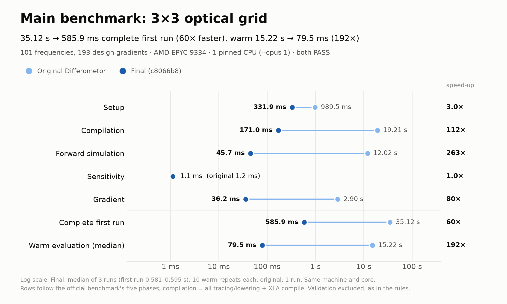
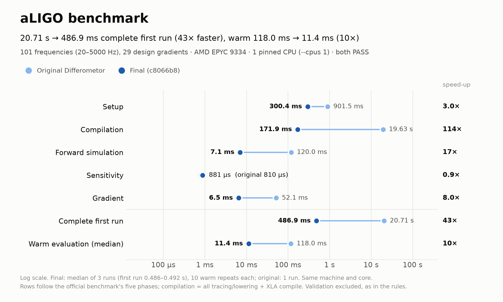
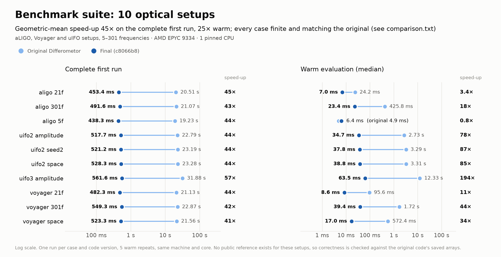

# Differometor, faster: Feyer "Faster Physics" submission

START Hack Munich 2026 · Feyer: Faster Physics · Team: TBD

This is the public [Differometor](https://github.com/artificial-scientist-lab/Differometor) simulator with a faster evaluation path. It keeps the same physics, every frequency, double precision and complete gradients, and it works for any optical setup, not only the development example. The scoring scripts (`benchmark.py`, `benchmark_aligo.py`, `plot_timings.py`) and the input data are the official files from [feyerlabs/start-hack-munich-2026](https://github.com/feyerlabs/start-hack-munich-2026) at `83f8d2f`, unchanged.

## Results

AMD EPYC 9334, one pinned logical CPU (`--cpus 1`), original code and ours on the same machine and core:

| Official benchmark | Original: complete first run | **Ours: complete first run** | Original: warm | **Ours: warm** | Check |
|---|---:|---:|---:|---:|---|
| `benchmark.py`, 3×3 grid (101 frequencies, 193 gradients) | 35.28 s | **0.585 s (60×)** | 15.48 s | **0.081 s (190×)** | PASS, max \|Δlog S\| 5.374e-6, the same as the original |
| `benchmark_aligo.py`, aLIGO (101 frequencies, 29 gradients) | 20.78 s | **0.490 s (42×)** | 0.122 s | **0.0116 s (10×)** | PASS, max \|Δlog S\| 2.9e-11 (limit 1e-6) |

- A 10-setup suite covers aLIGO, Voyager and uIFO, with 5–301 frequencies and 29–194 variables. The geometric-mean speed-up is **45×** on the complete first run and 25× warm, and every case matches the original code.
- A sweep of 20,000 frequencies (10 Hz – 20 kHz) on the grid, with the full gradient, takes **20 s** on one core. The original code needs about 20 s for 100 of those frequencies, and its dense matrices make 20,000 out of reach.

| Plot | Source |
|---|---|
|  | [results/epyc-c8066b8/main/](results/epyc-c8066b8/main/) |
|  | [results/epyc-c8066b8/aligo/](results/epyc-c8066b8/aligo/) |
|  | [results/epyc-c8066b8/suite/comparison.txt](results/epyc-c8066b8/suite/comparison.txt) |

Before/after JSON reports and plots: [results/amd-epyc-final/](results/amd-epyc-final/) holds one session with the original and every intermediate variant, 3 runs × 10 warm repeats each ([comparison.txt](results/amd-epyc-final/comparison.txt)). [results/epyc-c8066b8/](results/epyc-c8066b8/) holds the final code against the original on both official benchmarks and the suite. The official Intel Xeon baselines are in [benchmarks/](benchmarks/).

## Reproduce

Python 3.12 on Linux (or WSL2), as in [CHALLENGE_README.md](CHALLENGE_README.md):

```bash
python -m pip install -r requirements.txt
python -m pip install -e .            # compiles nothing: the C++ solver ships prebuilt
python benchmark.py --cpus 1 --output benchmark-final.json          # prints PASS
python benchmark_aligo.py --cpus 1 --output benchmark-aligo.json    # prints PASS
```

No compiler is needed. The solver ships prebuilt for Linux x86-64 in three CPU levels (baseline, AVX2, AVX-512), and the package loads the best one the CPU reports, so it cannot fail with an illegal instruction. All levels give bit-identical results. On other platforms `pip install -e .` compiles the solver if a C++ compiler is available. Without any native library the code falls back to SciPy's SuperLU, which also passes. A Docker setup is in [docker/](docker/) (`./container.bash`, `.\container.ps1`).

## What changed and why

The original spent about 19 s of its 35 s compiling XLA programs. Most of the remaining time went into dense LU on 751×751 systems that are 99.5 % zeros, six factorisations per frequency.

1. **Sparse, factorise once.** Only the nonzeros are assembled. One LU per frequency serves the forward solve, the adjoint solve and both gradient solves, so 606 factorisations become 101.
2. **One identity deletes a solve.** The quantum noise `Re(cᴴA⁻¹NA⁻ᴴc)` equals `Re(wᴴNw)` with `w = A⁻ᴴc`. This is exact for every invertible A, so it holds for any topology.
3. **The physics runs on the host, with JAX's own derivatives.** The whole simulation runs in NumPy/C++ inside one `jax.custom_vjp`, so XLA compiles two small stubs instead of the assembly graph. The component derivatives are not rewritten by hand: JAX's JVP program is transposed into the VJP (matches `jax.vjp` to 2.7e-16). Unsupported custom components fall back to traced JAX automatically.
4. **Our own sparse LU in C++** ([differometor/native/dfsparse.cpp](differometor/native/dfsparse.cpp)). It is a Gilbert–Peierls left-looking LU with a minimum-degree ordering. Frequency 0 is pivoted, and the other frequencies reuse its pivot order whenever every pivot stays at least 0.1× its column maximum. Every solve gets one step of iterative refinement.
5. **Cheaper compilation of what remains.** XLA's classic CPU emitters are selected before the backend starts, with bit-identical output. The solver is built with FMA contraction off, so every CPU level rounds identically.

The details, every experiment (including the rejected ones) and the runtime switches are in [OPTIMIZATION_LOG.md](OPTIMIZATION_LOG.md). There is also a short write-up in [docs/notes/approach.md](docs/notes/approach.md) and a report in [docs/report/main.pdf](docs/report/main.pdf).

## Correctness

- **Official checks.** Both official benchmarks print PASS: all frequencies, all design variables, `float64`/`complex128`, finite outputs, positive sensitivities, and the supplied gradient check.
- **Independent validation against the official implementation** ([FEYER_FINAL_VALIDATION.md](FEYER_FINAL_VALIDATION.md)). Every output array (carrier, signal, noise, sensitivity, powers, loss) and the full gradient agree with the official code to about 1e-10 on aLIGO and 1e-7 on the grid. Independent finite-difference checks agree with the gradient wherever float64 can resolve them. The few exceptions are near-zero parameters and roundoff-level gradients, where the official code fails the same check. Instrumented runs of the official scripts show every solve on the C++ solver, with no SciPy or JAX fallback.
- **Other setups.** In `tests/check_native_solver.py` the C++ solver agrees with SciPy SuperLU and the in-graph JAX path on 11 of 12 topologies (aLIGO ×3, Voyager, both grid fixtures, random 3×3 grids). The 12th, Voyager frequency modulation, is not determined in float64: a 1e-12 input change moves even the official dense code by 9 in log S. See also the [verification/](verification/) suite. On ill-conditioned setups, sparse LU with refinement is more accurate against 50-digit references than the original dense LU ([results/generality-e9.jsonl](results/generality-e9.jsonl)).

## Runtime switches

All switches default to the fastest correct path.

| Variable | Effect |
|---|---|
| `DIFFEROMETOR_NATIVE=0` | SciPy SuperLU instead of the C++ solver |
| `DIFFEROMETOR_BACKEND=jax` | the in-graph sparse JAX path (forward-mode AD, gradients w.r.t. other inputs) |
| `DIFFEROMETOR_XLA_FLAGS=exact\|fast\|0` | XLA compile flags; `fast` is 0.509 s but moves one sensitivity by 1 ulp, so it is opt-in |
| `DIFFEROMETOR_NATIVE_BUILD=1` | install time: compile a CPU-tuned solver instead of using the prebuilt one |

The full list is in [OPTIMIZATION_LOG.md](OPTIMIZATION_LOG.md#runtime-switches-all-default-to-the-fastest-correct-path).

## Layout

| Path | Contents |
|---|---|
| `differometor/` | the simulator: `host.py` (host path and adjoints), `native/` (C++ solver, prebuilt libraries, loader), `native_kernels.py`, `simulate.py`, `build.py`, `components.py` |
| `benchmark.py`, `benchmark_aligo.py`, `plot_timings.py`, `start_here.py` | official scripts, unchanged |
| `benchmark_suite.py`, `tools/compare_suite.py` | 10-setup generality suite |
| `tests/`, `verification/` | solver, adjoint and backend checks; verification against dense code and references |
| `tools/` | profiling and result-comparison helpers |
| `results/` | benchmark reports, plots and validation evidence |
| `docs/notes/`, `docs/report/` | approach notes and report |
| `CHALLENGE_README.md`, `challenge.pdf`, `judging-criteria.pdf`, `README.upstream.md` | official brief and upstream documentation |

The upstream [MIT license](LICENSE) is retained. [UPSTREAM.json](UPSTREAM.json) records the original simulator and fixture hashes.
